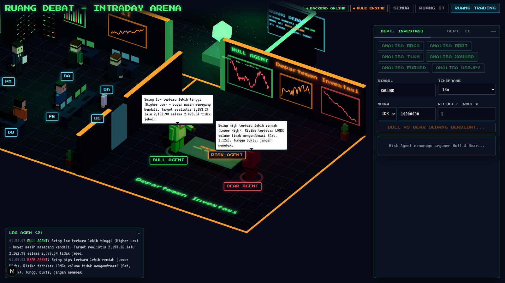

# AI Virtual Office & Trading Hub

Kantor virtual 3D isometrik berisi tim agen AI yang bekerja otonom:

- **Departemen IT** — PM → Analis Kebutuhan → Database → Backend → Frontend → QA.
- **Departemen Investasi (Intraday Arena)** — Bull Agent vs Bear Agent berdebat, Risk Agent memutuskan **BUY / SELL / WAIT** lewat kartu *Trading Plan*.




## Arsitektur

```
Next.js + Tailwind + React Three Fiber  ◀── Socket.IO ──▶  FastAPI + python-socketio
  (avatar, chat bubble, kanban, plan card)                    ├─ agents/it_department.py  (PM/BA/DB/BE/FE/QA)
                                                              ├─ agents/trading.py        (Bull/Bear/Risk)
                                                              ├─ market/data.py           (MT5 → yfinance → Twelve Data → sintetis)
                                                              ├─ market/indicators.py     (struktur, S/R, ATR, volume, wick)
                                                              ├─ risk.py                  (RR, ukuran posisi, tick IDX)
                                                              ├─ llm.py                   (OpenRouter + Google AI Studio)
                                                              └─ db.py                    (SQLite: log debat & plan)
```

### Prinsip penting

- **Angka tidak pernah dari LLM.** Entry, SL, TP, RR, dan ukuran posisi dihitung deterministik dari data candle. LLM hanya menulis argumen, dan Risk Agent (LLM) hanya boleh *menurunkan* keputusan menjadi WAIT, tidak boleh membuka posisi baru.
- **Hak veto Risk Agent** (aturan keras): batas rugi harian, volatilitas ekstrem (ATR%), selisih bukti Bull/Bear < 2 poin, RR TP2 < `MIN_RR` (default 1:1.5), TP1 < 1R, atau modal tidak cukup untuk 1 lot.
- **Jalan tanpa API key.** Tanpa key, semua agen memakai *rule engine* (badge `RULE ENGINE`). Jika sumber data live tidak terjangkau, data sintetis dipakai dan kartu diberi label **DATA SINTETIS — JANGAN dieksekusi**.
- Rahasia hanya di `.env` (lihat `.env.example`).

## Menjalankan

### 1. Backend (Python 3.11+)

```bash
cp .env.example .env            # isi OPENROUTER_API_KEY / GEMINI_API_KEY bila ada
cd backend
python -m venv .venv && source .venv/bin/activate   # Windows: .venv\Scripts\activate
pip install -r requirements.txt
uvicorn app.main:asgi --reload --port 8000
```

Opsional untuk forex real-time di Windows: `pip install MetaTrader5` dan buka terminal MT5. Sumber data lalu dipakai otomatis sesuai urutan MT5 → yfinance → Twelve Data.

### 2. Frontend (Node 20+)

```bash
cd frontend
cp .env.local.example .env.local   # NEXT_PUBLIC_BACKEND_URL=http://localhost:8000
npm install
npm run dev                         # http://localhost:3000
```

### 3. Tes

```bash
cd backend && pytest -q             # 19 tes: risk math, debat, pipeline IT (offline)
cd frontend && npm run typecheck && npm run build
```

## Model per peran

Semua model bisa diganti lewat `.env`. ID model gratis di OpenRouter sering berubah, jadi cek https://openrouter.ai/models?q=free.

| Peran | Variabel | Default |
|---|---|---|
| PM, Analis, QA | `MODEL_PM` (+ `GEMINI_MODEL` bila `GEMINI_API_KEY` diisi) | `google/gemma-3-27b-it:free` / `gemini-2.5-flash` |
| Risk Agent | `MODEL_RISK` (+ Gemini) | `google/gemma-3-27b-it:free` |
| DB / BE / FE | `MODEL_CODER` | `qwen/qwen-2.5-coder-32b-instruct:free` |
| Bull & Bear | `MODEL_DEBATE` | `meta-llama/llama-3.1-8b-instruct:free` |

> Catatan: `google/gemini-1.5-pro`, `google/gemma-31b-it:free`, dan `poolside/laguna-s-2.1:free` dari master plan tidak dijadikan default karena ketersediaannya tidak bisa saya pastikan. Silakan isi ke `.env` bila ID tersebut aktif di akun Anda.

## Simbol yang didukung

- Saham IDX: ketik kode saja (`BBCA`, `TLKM`, …), otomatis jadi `BBCA.JK`. Ukuran posisi dalam **lot (100 lembar)** dan harga dibulatkan ke fraksi harga BEI.
- Forex/komoditas: `XAUUSD`, `XAGUSD`, `EURUSD`, `GBPUSD`, `USDJPY`, `AUDUSD`, `USDIDR`, `BTCUSD`. Ukuran posisi dalam lot standar (100.000 unit; emas 100 oz).
- Akun IDR untuk instrumen USD memakai kurs asumsi `USD_IDR_RATE` (default 16.000) dan asumsi ini dicantumkan di kartu.

## API

| Method | Path | Keterangan |
|---|---|---|
| GET | `/api/health` | status, LLM aktif, departemen sibuk |
| POST | `/api/trade/analyze` | `{symbol, interval, capital, risk_pct, today_loss_pct, account_currency}` |
| POST | `/api/it/request` | `{prompt}` |
| GET | `/api/sessions`, `/api/sessions/{id}` | riwayat & log debat (SQLite) |
| GET | `/api/plans?symbol=BBCA` | riwayat trading plan |

Event Socket.IO: `agent:status`, `agent:message`, `it:tasks`, `it:task_status`, `it:result`, `trade:market`, `trade:plan`, `job:start|end|error`.

## Avatar Ready Player Me / Mixamo

Avatar default berupa voxel prosedural (banteng, beruang, orb hakim, dan staf IT) dengan animasi mengetik, berpikir, berdiri, dan berdebat. Untuk memakai `.glb` dari Ready Player Me, taruh file di `frontend/public/avatars/` lalu isi `glb: "/avatars/pm.glb"` pada agen terkait di `frontend/lib/agents.ts`.

## Roadmap

- Lip sync (Rhubarb) dan klip Mixamo untuk avatar `.glb`.
- Sentimen berita forex (Forex News API) sebagai bukti tambahan Bull/Bear.
- PostgreSQL untuk data pengguna/proyek IT; agen IT menulis langsung ke repo (PR otomatis).

> ⚠️ Bukan saran keuangan. Trading Plan adalah alat bantu analisa; selalu verifikasi sendiri sebelum eksekusi di MetaTrader/sekuritas.
